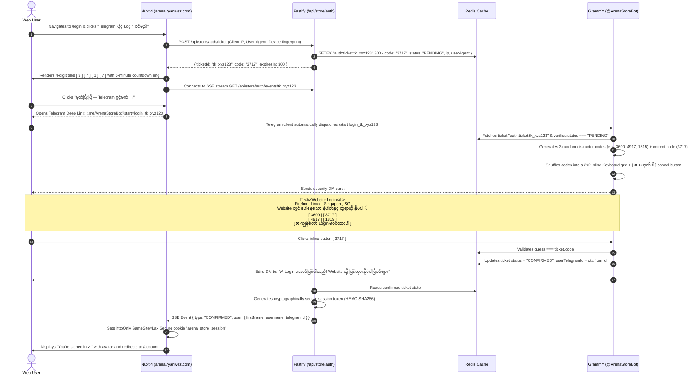

# Arena Store — Web Storefront Technical Overview & System Specification

## 1. Executive Summary & Purpose

Arena Store is currently operating as a Telegram-native digital storefront powered by `@arena/bot` (grammY framework), Fastify backend (`apps/api`), and Nuxt 3 administrative portal (`apps/admin`). The bot interface, while convenient and instant, is constrained by Telegram's chat message boundaries and button grid limitations.

The **Web Storefront** (`apps/web` hosted at `arena.ryanwez.com`) extends Arena Store into a full-scale, responsive web application and Telegram Mini App. Customers can browse catalog items, view rich 3D card representations, check stock in real-time, execute 1-click purchases using their existing prepaid MMK wallet, top up funds via auto MMQR or manual slip upload, reveal encrypted digital account credentials, and track lifetime referral commissions.

### Core Non-Negotiable Tenets
1. **Shared Unified Identity & Wallet (Zero New Signups):**
   - Web customers log in using their Telegram identity. There is no separate email/password registration.
   - The user's `telegramId` serves as the authoritative foreign key linking `users`, `wallets`, `orders`, and `topup_requests`.
   - Existing wallet balances, pending deposits, referral bonuses, and purchase history are 100% synchronized across Bot and Web in real time.
2. **Zero Code Duplication via `@arena/core`:**
   - Business logic (atomic conditional debit, advisory lock concurrency, upstream supplier fulfillment, AES-256-GCM encryption, catalog stock caching, referral commission calculations) is extracted from `apps/bot` into a clean shared package: `packages/core`.
   - Both `apps/bot` and `apps/api` consume `@arena/core`. A purchase placed on the web uses the exact same underlying service method as a purchase placed inside the bot.
3. **2026 Flat Monolithic Aesthetic (Strictly Zero Gradients, Zero Purple):**
   - Clean, high-contrast tech minimalism inspired by Linear, Nothing, and Apple Wallet.
   - Dominant deep carbon/graphite background (`#08090B`), flat matte card surfaces (`#101216`), razor-sharp 1px borders (`#1F232D`), and a single vibrant solid accent: **Signal Orange (`#FF5A1F`)**.

---

## 2. High-Level System Architecture

```text
                               ┌────────────────────────────────────────────────────────┐
                               │                 POSTGRESQL (Neon DB)                   │
                               │  users · wallets · wallet_ledger · orders · deliveries │
                               │        topup_requests · products · categories          │
                               └───────────────────────────┬────────────────────────────┘
                                                           │
                                                           ▼
                                      ┌────────────────────────────────────────┐
                                      │           @arena/core (NEW)            │
                                      │   Shared Multi-Process Safe Engine     │
                                      │  • Atomic Wallet Debit (Advisory Lock) │
                                      │  • Upstream Supplier Client (AES-GCM)  │
                                      │  • MMPay & Slip Top-Up State Machine   │
                                      │  • 3% Commission & Referral Engine     │
                                      └───────┬────────────────────────┬───────┘
                                              │                        │
                       ┌──────────────────────┴───────┐        ┌───────┴────────────────────────┐
                       ▼                              ▼        ▼                                ▼
            [ apps/bot (grammY) ]              [ apps/api (Fastify) ]                [ apps/admin (Nuxt 3) ]
             • Telegram Inline Menus            • /api/store/auth/*                   • Orders Fulfillment
             • 4-Digit Match Callback           • /api/store/orders                   • Manual Slip Review
             • Direct DM Receipts               • /api/store/wallet                   • Rates & Stock Limits
                       │                               │
                       │ (Mini App Webview)            │ (REST / SSE)
                       ▼                               ▼
            ┌──────────────────────────────────────────────────────────────────┐
            │                     apps/web (Nuxt 4 Storefront)                 │
            │                  Domain: arena.ryanwez.com                       │
            │  • Mobile: 2-Col Bento + 3D Card Stack + Bottom Navigation Bar   │
            │  • Desktop: 4-Col Grid + Left Rail + Spacious Header             │
            │  • 2026 Flat Solid Aesthetic (Signal Orange #FF5A1F)             │
            └──────────────────────────────────────────────────────────────────┘
```

---

## 3. Dual Authentication Engine

The storefront accommodates two customer entry points with zero friction:

### Flow A: W3K-Style 4-Digit Bot Handshake (External Desktop & Mobile Browsers)
For users visiting `arena.ryanwez.com` through Chrome, Safari, Firefox, or Edge without being inside Telegram:



#### Security Properties of Flow A:
- **Zero Phishing Risk:** The user cannot enter credentials on a rogue site; authentication requires physical interaction inside their own authenticated Telegram client.
- **Contextual Security Metadata:** The Telegram DM displays the client's browser, operating system, and IP location, allowing the user to reject unauthorized access attempts immediately.
- **Short-Lived Ephemeral State:** Login tickets expire strictly after 300 seconds (5 minutes) in Redis.
- **Replay Protection:** Tickets are single-use; upon confirmation, the ticket is immediately deleted or marked consumed.

---

### Flow B: Telegram Mini App Instant Bypass (Zero-Click Auto-Login)
When the storefront is launched directly inside Telegram via the Bot Menu Button or an inline Mini App button:
1. Telegram WebApp container injects `window.Telegram.WebApp.initData` into the frontend context.
2. `apps/web` detects the presence of `Telegram.WebApp.initData` during client initialization.
3. The client sends `POST /api/store/auth/telegram-webapp` with `{ initData }`.
4. The server parses the query string, extracts `hash`, computes HMAC-SHA256 of the data-check-string against `HMAC_SHA256("WebAppData", TELEGRAM_BOT_TOKEN)`, and verifies signature authenticity.
5. If valid, the customer's Telegram profile (`id`, `first_name`, `username`) is extracted, synced via `getOrCreateUser()`, and an authenticated session cookie is issued in `< 100ms`.
6. **The customer is logged in instantly without clicking any login buttons.**

---

## 4. Concurrency, Money Safety & Ledger Discipline

### 1. PostgreSQL Transaction-Level Advisory Lock
To guarantee that concurrent requests across the Bot process and Web API process never double-spend customer wallet balances:
```typescript
const lockAcquired = await tx.execute(
  sql`SELECT pg_try_advisory_xact_lock(hashtext(${'user:' + telegramId})) as acquired`
);
if (!lockAcquired.rows[0]?.acquired) {
  throw new Error("OPERATION_IN_PROGRESS");
}
```
If two purchases arrive within the same millisecond (e.g., bot click + web click), the second transaction immediately aborts with an atomic refusal.

### 2. Guarded Conditional Balance Deduction
Wallet balances are decremented using strict SQL inequality constraints:
```typescript
const [updatedWallet] = await tx
  .update(wallets)
  .set({
    balanceMmk: sql`${wallets.balanceMmk} - ${totalMmk}`,
    totalSpentMmk: sql`${wallets.totalSpentMmk} + ${totalMmk}`,
    updatedAt: new Date(),
  })
  .where(and(eq(wallets.id, wallet.id), gte(wallets.balanceMmk, totalMmk)))
  .returning();

if (!updatedWallet) {
  throw new Error("INSUFFICIENT_FUNDS");
}
```
This is mathematically immune to race conditions. Negative balances are physically impossible at the database engine level.

### 3. Paired Atomic Ledger Audit Trail
Within the exact same database transaction as the balance decrement, a row is inserted into `wallet_ledger`:
```typescript
await tx.insert(walletLedger).values({
  walletId: updatedWallet.id,
  amountMmk: -totalMmk,
  type: "ORDER_DEBIT",
  referenceId: publicOrderNo,
  notes: `Purchase: ${product.name} x ${quantity}`,
});
```
The sum of customer ledger transactions will always equal `wallet.balanceMmk` without drift.

### 4. Upstream Fulfillment & Automatic Compensation (Refund)
Only after the wallet deduction transaction successfully commits does the system dispatch an external API call to upstream suppliers (XPro or DigitalCore). If the supplier returns an out-of-stock error or network failure:
```typescript
await creditWallet(telegramId, totalMmk, "REFUND", `Auto-refund for failed order ${publicOrderNo}`);
```
The customer's funds are credited back atomically, and the order is marked `CANCELLED` with the failure reason documented.

### 5. Encrypted Credentials Vault (AES-256-GCM)
Upstream digital credentials (passwords, tokens, product license keys) are encrypted before insertion into `deliveries`:
- Algorithm: `AES-256-GCM` with a unique 12-byte initialization vector (`iv`) and 16-byte authentication tag (`authTag`).
- Credentials are never rendered in plain text on order summary lists.
- When the customer taps **`👁️ Eye Reveal Key`**, an authorized API call (`GET /api/store/orders/:id/credentials`) verifies ownership, decrypts the payload in memory, and returns it to the client for temporary viewing and 1-click clipboard copying.

---

## 5. API Surface Specification (`apps/api/src/routes/store/*`)

All customer store routes sit under `/api/store/*`. Authentication is enforced via the `arena_store_session` cookie (or Bearer token fallback for API consumers).

### Authentication & Sessions
| Method | Route | Description |
|---|---|---|
| `POST` | `/api/store/auth/ticket` | Creates a new 4-digit challenge ticket for browser login. Returns `{ ticketId, code, expiresIn }`. |
| `GET` | `/api/store/auth/events/:ticketId` | Server-Sent Events (SSE) stream alerting the web frontend when the ticket is confirmed in Telegram. |
| `POST` | `/api/store/auth/telegram-webapp` | Validates Telegram Mini App `initData` signature and establishes instant session. |
| `GET` | `/api/store/auth/me` | Returns active customer session profile (`telegramId`, `name`, `username`, `memberSince`, `role`). |
| `POST` | `/api/store/auth/logout` | Clears active browser session cookie. |
| `POST` | `/api/store/auth/logout-all` | Invalidates all active session tokens for the current user across all devices. |

### Catalog & Products
| Method | Route | Description |
|---|---|---|
| `GET` | `/api/store/catalog/categories` | Returns active categories with clean display names and sort orders (cached 60s). |
| `GET` | `/api/store/catalog/products` | Returns sellable products filtered by `categoryId` with pricing in MMK and stock counts (cached 30s). |
| `GET` | `/api/store/catalog/products/:id` | Returns single product details, tier options, and supplier ETA. |

### Wallet & Top-Up
| Method | Route | Description |
|---|---|---|
| `GET` | `/api/store/wallet` | Returns customer's live wallet balance in MMK, total deposited, and total spent. |
| `GET` | `/api/store/wallet/ledger` | Paginated transaction history (credits, debits, refunds, referral bonuses). |
| `POST` | `/api/store/wallet/topup/mmqr` | Initiates instant MMPay MMQR top-up invoice. Returns `{ reference, qrString, expiresAt }`. |
| `GET` | `/api/store/wallet/topup/mmqr/status/:ref` | Polling endpoint for real-time QR payment confirmation. |
| `POST` | `/api/store/wallet/topup/slip` | Multipart image upload for KPay/WavePay transaction slips forwarded directly to Telegram Admin Group. |

### Orders & Fulfillment
| Method | Route | Description |
|---|---|---|
| `POST` | `/api/store/orders` | Executes 1-click wallet purchase. Body: `{ productId, quantity }`. Returns order details & credentials. |
| `GET` | `/api/store/orders` | Returns list of user's past orders with order numbers, timestamps, MMK totals, and delivery statuses. |
| `GET` | `/api/store/orders/:id/credentials` | Decrypts and reveals credentials for a DELIVERED order. |

### Referral & Rewards
| Method | Route | Description |
|---|---|---|
| `GET` | `/api/store/referral/stats` | Returns total friends referred, active/qualified referrals, total earned bonus MMK, and lifetime 3% commissions. |
| `GET` | `/api/store/referral/link` | Returns customer's personalized invite links (`t.me/ArenaStoreBot?start=ref_<id>` and web URL). |

---

## 6. Frontend UI/UX Design System (`apps/web`)

### Master Design Visuals

The storefront UI implements the 4 approved master design benchmarks:

#### 1. Desktop Storefront Benchmark


#### 2. Desktop Customer Dashboard Benchmark


#### 3. Mobile Storefront Benchmark (iPhone 9:16)


#### 4. Mobile Customer Dashboard Benchmark (iPhone 9:16)


---

### Design System Tokens (2026 Flat Monolithic)

```css
:root {
  /* Color Palette - Strictly Zero Gradients, Zero Purple */
  --bg-page: #08090B;               /* Deep Monolithic Carbon */
  --bg-surface: #101216;            /* Flat Matte Surface */
  --bg-surface-elevated: #161920;   /* Elevated Card Surface */
  --bg-surface-hover: #1C202A;      /* Interactive Hover State */
  
  --border-subtle: #1F232D;         /* 1px Perimeter Structure */
  --border-strong: #2F3545;         /* Focused/Elevated Border */
  --border-active: #FF5A1F;         /* Active Indicator */

  --text-primary: #F4F5F7;          /* High-Contrast Off-White */
  --text-secondary: #8B92A4;        /* Muted Slate Supporting Text */
  --text-tertiary: #5A6173;         /* Subtle Metadata */

  --accent: #FF5A1F;                /* Solid Signal Orange - Primary Actions */
  --accent-hover: #FF6E38;          /* Hover Solid */
  --accent-subtle: rgba(255, 90, 31, 0.12);

  --success: #10B981;               /* Solid Emerald (Delivered, In-Stock, TG Verified) */
  --warning: #F59E0B;               /* Solid Amber (Processing, Low Stock) */
  --danger: #EF4444;                /* Solid Coral Red (Cancel, Rejected) */

  /* Typography */
  --font-heading: 'Plus Jakarta Sans', 'Inter Tight', system-ui, sans-serif;
  --font-mono: 'JetBrains Mono', monospace;
  --font-burmese: 'Noto Sans Myanmar', -apple-system, sans-serif;
}
```

### Layout Architecture: Mobile-First Unification

| Component | Mobile Phone Viewport (375px - 430px) & Mini App | Desktop Viewport (1024px - 1440px+) |
|---|---|---|
| **Header** | Sticky top bar with `ARENA` logo, `12,500 MMK +` wallet chip, and Telegram avatar. | Floating frosted glass navbar with command-palette search, wallet badge, and avatar dropdown. |
| **Hero 3D Showcase** | Center stage 3D swipeable card carousel (ChatGPT Plus, Notion, Canva) with `< 01/03 >` pagination. | 2-column layout: Left typography & search, Right floating 3D tilted card stack on podium. |
| **Category Filter** | Horizontal momentum-scrolling pill bar with category icons and counters. | Horizontal pill bar + category dropdown filter. |
| **Product Grid** | **2-Column Bento Grid**: Squircle app icons, `● In stock` status dot, MMK price, quick cart tap. | **4-Column Bento Grid**: Expanded card details, multi-tier preview, hover elevation. |
| **Account View** | Apple Wallet style full-width **Black Titanium Member Card** (EMV chip, masked ID, `✓ TG VERIFIED`). Underneath: Full-width balance card + Orange `+ Top Up` button. | 3-column top bento (Member Card, Balance Tile, Referral Tile) + Full-width Recent Orders table below. |
| **Navigation** | **Frosted Glass Bottom Navigation Bar**: `[ 🏠 Home ] [ ⊞ Products ] [ 📄 Orders ] [ 👤 Profile ]` with iOS safe-area inset. | Fixed Left Navigation Rail with clean icons and category groupings. |

---

## 7. Motion & Interaction Engineering

In adherence with AGENT.md interaction rules (*"calm, polished, never jumpy; ordinary buttons must not translate on hover"*):

1. **Native Browser View Transitions API (`experimental.viewTransition` in Nuxt 4):**
   - Route transitions use smooth document cross-fades without jarring white flashes.
   - When tapping a product card from the grid, the app icon and title morph seamlessly into the Product Detail view using shared `view-transition-name` identifiers.
2. **Spring Physics Layout Transitions (`motion-v`):**
   - When switching category filters, product cards do not abruptly unmount. They animate into their new positions using calm spring physics (`stiffness: 300, damping: 30`).
   - Drawers and bottom sheets (Login modal, Deficit top-up sheet) slide up with gentle dampening.
3. **Data Micro-Interactions (CSS Engine):**
   - **Wallet Number Ticker:** Balance updates animate with a rolling digit transition.
   - **MMQR Circular Countdown:** Realtime SVG ring `stroke-dashoffset` smoothly decrements every second.
   - **Haptic Feedback (Mini App):** Tapping buy or top-up triggers native `Telegram.WebApp.HapticFeedback.impactOccurred('medium')`.
   - **Accessibility:** All animations gracefully deactivate when `prefers-reduced-motion: reduce` is detected.

---

## 8. Deployment & Infrastructure Strategy

- **Domain:** `arena.ryanwez.com`
- **Application Engine:** Nuxt 4 Universal SSR running under Node.js 22 LTS / Nitro.
- **Routing & SSL:** Cloudflare Tunnel forwarding requests to internal port `3002` (`apps/web`).
- **CORS Configuration:** `apps/api` allows `https://arena.ryanwez.com` with `credentials: true`.
- **Environment Variables:**
  - `TELEGRAM_BOT_TOKEN`: Required for Mini App `initData` HMAC validation.
  - `API_BASE_URL`: Points to internal Fastify backend (`http://localhost:3000`).
  - `PUBLIC_STORE_URL`: `https://arena.ryanwez.com`.
  - `SESSION_SECRET`: 32-byte secret for cookie signing.
