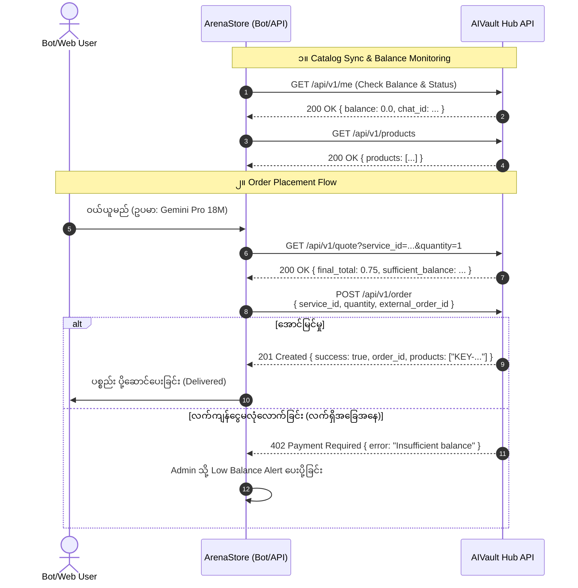

# AIVault Hub Supplier Integration Analysis & Feasibility Report

> **အကျဉ်းချုပ်:** လက်ရှိ ArenaStore တွင် ချိတ်ဆက်ထားသော Supplier နှစ်ခု (`XPro`, `DigitalCore`) ၏ Architecture ပုံစံကို လေ့လာပြီးနောက်၊ တတိယမြောက် Supplier အသစ်ဖြစ်သည့် **AIVault Hub** (`reseller.aivaulthub.store`) ၏ API Documentation နှင့် Live API Endpoint များကို စစ်ဆေးသုံးသပ်ထားသော ပြည့်စုံသည့် စစ်တမ်းအစီရင်ခံစာ ဖြစ်ပါသည်။

---

## ၁။ AIVault Hub ဆိုင်ရာ အခြေခံ အချက်အလက်များ (Overview)

| အကြောင်းအရာ | အသေးစိတ် အချက်အလက် |
|---|---|
| **Supplier အမည်** | **AIVault Hub** |
| **API Base URL** | `https://reseller.aivaulthub.store/api/v1` |
| **Portal / Documentation** | `https://reseller.aivaulthub.store/api/v1/docs` |
| **Authentication နည်းလမ်း** | Header `X-API-Key: <YOUR_API_KEY>` |
| **ငွေကြေးစနစ် (Currency)** | USD (Fixed conversion: `1 USD = 100 INR`) |
| **Rate Limit** | တစ်မိနစ်လျှင် 60 requests (`X-RateLimit-*` headers ပြန်ပေးသည်) |
| **Live API စမ်းသပ်မှု ရလဒ်** | **ချိတ်ဆက်မှု အောင်မြင်သည် (HTTP 200)**<br>• Account Chat ID: `8777968077`<br>• လက်ကျန်ငွေ: `$0.00 USD` |

---

## ၂။ ဘာပစ္စည်းတွေ ရနိုင်သလဲ (Current Catalog & Inventory)

Live API (`GET /api/v1/products`) မှ ရရှိသော တကယ့် လက်ရှိ ကုန်ပစ္စည်းစာရင်းနှင့် Stock အခြေအနေမှာ အောက်ပါအတိုင်း ဖြစ်ပါသည်-

| Product ID (`service_id`) | ကုန်ပစ္စည်းအမည် | လက်ရှိ Stock | Base Price (USD) | Bulk / Tiers Discount | ပစ္စည်းပုံစံ (Delivery Format) |
|---|---|:---:|:---:|:---:|:---:|
| `service_gemini_reactivate` | **Gemini Links 18m New Url** | **5,310** | **\$0.75** | Tier (1–10,000: \$0.75) | Activation URL / Invite Link |
| `service_gemini_static` | **Gemini Pro 18M (Static Domain)** | **828** | **\$0.75** | Tier (1–10,000: \$0.75) | Activation URL / Token |
| `service_1789191781` | **Adobe Express 12M** | **162** | **\$0.40** | Tier (1–1,000: \$0.40) | License Key / Voucher |
| `service_1789191878` | **Apple Music 5M** | **50** | **\$0.40** | Tier (1–1,000: \$0.40) | Redeem Code / Link |
| `service_gemini_instant` | Gemini URL (Instant Use ⚡) | 0 (ပြတ်နေ) | \$0.40 | Tier (1–1,000: \$0.40) | Activation URL |
| `service_1789190756` | Duolingo 12M | 0 (ပြတ်နေ) | \$0.25 | Tier (1–1,000: \$0.25) | Redeem Link / Key |
| `service_gmail_normal` | Gmail Normal Accounts | 0 (ပြတ်နေ) | \$0.50 | 1–10: \$0.50<br>11–1000: \$0.45 | Account Credentials |
| `service_1788186586` | Netflix 1M 4K HDR | 0 (ပြတ်နေ) | \$10.00 | Tier (1–100: \$10.00) | Account Credentials |
| `service_1790855554` | ChatGPT Plus UPI (24H) | 0 (ပြတ်နေ) | \$5.00 | 1–3: \$5.00<br>4–7: \$4.60<br>7–1000: \$4.20 | Activation Voucher |

### ကုန်ပစ္စည်းဆိုင်ရာ အဓိက သုံးသပ်ချက်များ
1. **AI & Productivity အဓိကရနိုင်သည်:** အထူးသဖြင့် `Gemini Pro 18M` အမျိုးအစား နှစ်မျိုးစလုံးတွင် Stock အများအပြား (စုစုပေါင်း 6,000 ကျော်) ရှိပြီး ဈေးနှုန်းမှာ **\$0.75** ဖြစ်သည်။
2. **Adobe Express & Apple Music:** Stock အသင့်အတင့် ရှိပြီး စျေးနှုန်း **\$0.40** ဖြင့် ရရှိနိုင်သည်။
3. **Delivery Format:** Product ရလဒ်များသည် string array အဖြစ် ထွက်လာသည် (`products: ["KEY-...", "https://..."]`)။ DigitalCore ကဲ့သို့ URL သို့မဟုတ် Token/Key ပုံစံများ ဖြစ်သောကြောင့် ArenaStore ၏ `DeliveryType.LINK` သို့မဟုတ် `DeliveryType.CODE` စနစ်နှင့် အလွန်ကိုက်ညီပါသည်။

---

## ၃။ API ဘယ်လို အလုပ်လုပ်သလဲ (How AIVault Hub API Works)

AIVault Hub API သည် Reseller Bot များအတွက် သီးသန့် ရည်ရွယ်တည်ဆောက်ထားပြီး ခေတ်မီသော Features များ ပါဝင်ပါသည်-



### အဓိက Endpoints များ

1. **`GET /api/v1/me`**
   - Reseller အကောင့် Balance နှင့် Telegram Chat ID ကို စစ်ဆေးသည့်နေရာ။
   - Health check အဖြစ် အသုံးပြုနိုင်သည်။
   - Response: `{"chat_id": 8777968077, "balance": 0.0, "currency": "USD"}`

2. **`GET /api/v1/products`**
   - လက်ကျန် Stock နှင့် Tiers စျေးနှုန်းများ ပါဝင်သော Catalog စာရင်း အပြည့်အစုံ ရယူခြင်း။
   - Pagination မလိုဘဲ တစ်ခါတည်း အကုန်ပြန်ပေးသည်။

3. **`GET /api/v1/quote?service_id={id}&quantity={qty}`**
   - Order မတင်မီ ငွေပမာဏ၊ Discount တွက်ချက်မှုနှင့် လက်ကျန်ငွေ လုံလောက်မှု ရှိမရှိ စစ်ဆေးနိုင်သည့် preview endpoint။

4. **`POST /api/v1/order`**
   - ပစ္စည်းဝယ်ယူသည့် အဓိက endpoint ဖြစ်သည်။
   - Payload:
     ```json
     {
       "service_id": "service_gemini_static",
       "quantity": 1,
       "external_order_id": "ARENA-ORD-20261029-001",
       "accept_normal_price": true
     }
     ```
   - **Atomic Single-Commit Settlement:** ငွေနှုတ်ခြင်းနှင့် ပစ္စည်းထုတ်ပေးခြင်းကို single database transaction ဖြင့် လုပ်ဆောင်သောကြောင့် network ပြတ်တောက်မှုကြောင့် ငွေအလဟဿ နှုတ်သွားခြင်း မရှိပါ။
   - **Idempotency Guarantee:** `external_order_id` ထည့်ပေးနိုင်သောကြောင့် Timeout ဖြစ်၍ ArenaStore ဘက်မှ ထပ်မံ retry ခေါ်ပါက ငွေနှစ်ခါမနှုတ်ဘဲ နဂို order ကိုသာ `idempotent_replay: true` ဖြင့် ပြန်ပေးသည်။

5. **`GET /api/v1/order/{order_id}`**
   - ယခင် ဝယ်ယူထားသော Order တစ်ခု၏ အခြေအနေနှင့် ပို့ဆောင်ထားသော Product Codes/Keys များကို ပြန်လည်ရယူခြင်း။

6. **`GET /api/v1/orders?page=1&limit=20` & `GET /api/v1/orders/export`**
   - Reseller Order History နှင့် စာရင်းစစ် (Audit/Ledger) အတွက် CSV/JSON ဒေါင်းလုဒ် ရယူနိုင်ခြင်း။

7. **`POST /api/v1/keys/rotate`**
   - API Key ပေါက်ကြားပါက သို့မဟုတ် လုံခြုံရေးအရ အသစ်လဲလှယ်လိုပါက API မှတစ်ဆင့် key အသစ် ချက်ချင်းထုတ်ယူနိုင်ခြင်း။

8. **Webhooks Engine (`POST /api/v1/webhooks`)**
   - ပစ္စည်း Restock စောင့်ရသောအခါ `order.queued` မှ `order.delivered` ဖြစ်သွားပါက Bot သို့ HTTPS Webhook ဖြင့် Push Notification ပေးပို့ခြင်း (HMAC-SHA256 signature ပါဝင်)။

---

## ၄။ ရှိပြီးသား Suppliers များနှင့် နှိုင်းယှဉ်ချက် (Architectural Comparison)

ArenaStore တွင် လက်ရှိ သုံးနေသော `XPro`၊ `DigitalCore` နှင့် အသစ်ထည့်မည့် `AIVault Hub` တို့၏ နှိုင်းယှဉ်ချက်မှာ အောက်ပါအတိုင်း ဖြစ်ပါသည်-

| အင်္ဂါရပ် (Feature) | XPro | DigitalCore | AIVault Hub | AIVault Hub ၏ အားသာချက်/မှတ်ချက် |
|---|:---:|:---:|:---:|---|
| **Product ID ပုံစံ** | Integer string (`"1"`, `"12"`) | Text Slug (`"gemini_pro_18_months"`) | String ID (`"service_gemini_static"`) | ArenaStore ၏ `varchar(100)` upstreamProductId တွင် တိုက်ရိုက် သုံးနိုင် |
| **Idempotency (`externalOrderId`)** | ✅ ရရှိသည် | ❌ **လုံးဝမရပါ** (Retry လုပ်လျှင် ငွေနှစ်ခါနှုတ်နိုင်) | ✅ **ရရှိသည်** (`external_order_id`) | **လုံခြုံစိတ်ချရမှု အလွန်မြင့်မားသည်**။ Timeout ဖြစ်၍ retry လုပ်လျှင် ငွေမနှုတ် |
| **Atomic Transaction** | Upstream စနစ်အလိုက် | Database row lock သာရှိ | ✅ **Single-commit atomic** | ပစ္စည်းမထွက်ပါက ငွေလုံးဝမနှုတ် |
| **Pre-order Quote Endpoint** | ❌ မရှိ | ❌ မရှိ | ✅ **ရှိသည် (`GET /quote`)** | Order မတင်မီ ဈေးနှုန်းနှင့် လက်ကျန်ငွေ ကြိုတင်စစ်ဆေးနိုင် |
| **Delivery Items ပုံစံ** | `lines` (`username:password`) | `items: string[]` + `view_url` | `products: string[]` | Activation link / voucher keys ပုံစံဖြစ်ပြီး DigitalCore ပုံစံနှင့် ဆင်တူ |
| **Rate Limit ကန့်သတ်ချက်** | Generic | Generic | 60 req/min (`X-RateLimit-*`) | Headers မှ ကျန်ရှိသော quota ကို တိကျစွာ သိရှိနိုင် |
| **Low Stock Buffer Conflict** | မရှိ | 400 Out of Stock | 409 Buffer Conflict | `accept_normal_price: true` ဖြင့် bypass လုပ်ရမည် |
| **Webhooks စနစ်** | ❌ မရှိ | ❌ မရှိ | ✅ **ရှိသည် (HMAC-SHA256)** | Delayed fulfillment များအတွက် အလွန် အသုံးဝင် |

---

## ၅။ ArenaStore ထဲသို့ AIVault Hub ထည့်သွင်းရန် လိုအပ်မည့် အဆင့်များ (Implementation Plan)

ArenaStore ၏ လက်ရှိ codebase သည် Supplier နှစ်ခုတည်းအတွက်သာ ရေးဆွဲထားခြင်း မဟုတ်ဘဲ multi-supplier architecture အဖြစ် ပြင်ဆင်ထားပြီး ဖြစ်သောကြောင့် ထည့်သွင်းရာတွင် အလွန်ရှင်းလင်း ချောမွေ့ပါသည်-

### ၁။ `packages/suppliers` ထဲတွင် Client အသစ် တည်ဆောက်ခြင်း
- `packages/suppliers/src/types.ts`: `SupplierId` တွင် `"AIVAULTHUB"` ထပ်ဖြည့်ခြင်း။
  ```ts
  export type SupplierId = "XPRO" | "DIGITALCORE" | "AIVAULTHUB";
  ```
- `packages/suppliers/src/aivaulthub.ts`: `ISupplierClient` interface ကို implement လုပ်သော `AIVaultHubClient` class အသစ် ရေးသားခြင်း (Base URL: `https://reseller.aivaulthub.store/api/v1`, Header: `X-API-Key`)။
- `packages/suppliers/src/errors.ts`: `SupplierError.fromAIVaultHub()` mapper ထည့်သွင်းခြင်း (Status 402 ကို `INSUFFICIENT_BALANCE`၊ 409 ကို `Buffer Stock Conflict` အဖြစ် map လုပ်ခြင်း)။
- `packages/suppliers/src/index.ts`: `createSupplierClient` factory တွင် switch case ထည့်သွင်းခြင်း။

### ၂။ Database Schema အခြေအနေ
- **Database Migration မလိုပါ!**
- `products.supplier`, `product_supplier_snapshots.supplier`, `deliveries.supplier` စသည့် နေရာအားလုံးတွင် `varchar(50)` ဖြင့် တည်ဆောက်ထားပြီး ဖြစ်၍ `"AIVAULTHUB"` တန်ဖိုးကို တိုက်ရိုက် သိမ်းဆည်းနိုင်ပါသည်။
- Composite Index `(supplier, upstream_product_id)` ရှိပြီးသား ဖြစ်သဖြင့် Product ID collision ဖြစ်ပွားခြင်း လုံးဝ မရှိနိုင်ပါ။

### ၃။ Environment Variables သတ်မှတ်ခြင်း
- `.env` နှင့် `.env.example` တွင် အောက်ပါတို့ကို ထည့်သွင်းမည်-
  ```env
  AIVAULTHUB_BASE_URL="https://reseller.aivaulthub.store/api/v1"
  AIVAULTHUB_API_KEY="rsk_drlS9krx2vnbr-dOZaxTLe1ROYicWp1ykivzO_kLE5U"
  SUPPLIERS_ENABLED="XPRO,DIGITALCORE,AIVAULTHUB"
  ```
- `apps/api/src/config.ts` တွင် validation schema ဖြည့်သွင်းခြင်း။

### ၄။ Catalog Sync & Order Execution ချိတ်ဆက်ခြင်း
- `packages/core/src/services/catalog.service.ts`:
  - `syncCatalog` ခေါ်ဆိုသည့်အခါ `AIVAULTHUB` ပါဝင်စေပြီး ကုန်ပစ္စည်းများကို `products` နှင့် `product_supplier_snapshots` ထဲသို့ automatic sync လုပ်ခြင်း။
  - `getSupplierWalletBalance` တွင် AIVault Hub balance cache ထည့်သွင်းခြင်း။
- `packages/core/src/services/order.service.ts`:
  - Customer ဝယ်ယူသော ကုန်ပစ္စည်း၏ supplier က `"AIVAULTHUB"` ဖြစ်ပါက `AIVaultHubClient.createOrder()` ကို ခေါ်ယူစေပြီး ရရှိလာသော digital codes များကို encrypt လုပ်၍ `deliveries` table တွင် သိမ်းဆည်းခြင်း။

### ၅။ Admin Dashboard UI
- `apps/admin/pages/products.vue` နှင့် `apps/admin/pages/supplier.vue`:
  - Supplier filter tab တွင် `AIVaultHub` ခလုတ်နှင့် Badge အသစ် (Cyan/Emerald အရောင်) ထည့်သွင်းခြင်း။
  - Balance indicator bar တွင် AIVault Hub ၏ USD လက်ကျန်ငွေကို live ပြသပေးခြင်း။
  - Diagnostics status (Ping, Latency, API Key validity) ပြသပေးခြင်း။

---

## ၆။ အနှစ်ချုပ်နှင့် အကြံပြုချက် (Recommendation)

1. **API အဆင်သင့်ဖြစ်မှု:** AIVault Hub API သည် အလွန်သပ်ရပ်ပြီး `external_order_id` (Idempotency) ပါဝင်သောကြောင့် DigitalCore ထက်ပင် စိတ်ချရမှု ပိုမိုအားကောင်းပါသည်။
2. **လက်ရှိ ကုန်ပစ္စည်း အလားအလာ:** Gemini Pro 18M (Stock: 6,000+), Adobe Express, Apple Music စသည့် ပစ္စည်းများ ချက်ချင်း ရောင်းချနိုင်ပါသည်။
3. **ငွေဖြည့်သွင်းမှု (Deposit):** လက်ရှိတွင် Balance `$0.00` ဖြစ်နေသဖြင့် Customer များ စတင်ဝယ်ယူနိုင်ရန် AIVault Hub Reseller Portal တွင် ကြိုတင်ငွေ (Deposit/Balance) ဖြည့်သွင်းထားရန် လိုအပ်ပါမည်။
4. **ရှေ့ဆက်လုပ်ဆောင်မှု:** Codebase ထဲသို့ `AIVaultHubClient` ထည့်သွင်းခြင်းနှင့် Catalog Sync ပြုလုပ်ရန် အတည်ပြုပါက အထက်ပါ အဆင့် ၅ ဆင့်အတိုင်း ဆက်လက် အကောင်အထည်ဖော် ပေးနိုင်ပါသည်။

